---
Component Selection
---

### Op-Amps

**Operational Amplifiers**

| **Solution** | **Image** | **Pros** | **Cons** |
| --- | --- | --- | --- |
| MCP6022-I/P |  | \* Two op-amp channels in one package \* Higher bandwidth of approximately 10 MHz \* Faster slew rate than the MCP6004 \* Suitable for higher-speed analog signals | \* Requires a supply voltage of approximately 2.5V to 5.5V \* Higher power consumption than the MCP6004 \* Only two channels per package |
| MCP6004-I/P |  | \* Four op-amp channels in one package \* Rail-to-rail input and output \* Low power consumption \* Operates from 1.8V to 6V | \* Lower bandwidth of 1 MHz \* Relatively slow slew rate of 0.6 V/µs \* Higher channel count may be unnecessary for simple circuits |
| MCP6244-E/P | 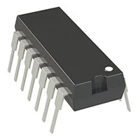 | \* Four op-amp channels in one package \* Rail-to-rail operation \* Extended-temperature option \* Suitable for low-voltage circuits | \* Requires verification of bandwidth and output drive for the application \* Extended-temperature rating may be unnecessary \* Supply voltage compatibility must be checked |

**Choice:** Option 2: MCP6004-I/P quad operational amplifier

**Rationale:** The MCP6004-I/P is the preferred choice because it provides four operational amplifier channels in a single package while maintaining low power consumption. Its rail-to-rail input and output capabilities make it suitable for low-voltage analog circuits. Its relatively low bandwidth is appropriate for applications that do not require high-speed signal processing.

### 5V 1.5 A Voltage Regulator

**Voltage Regulators**

| **Solution** | **Image** | **Pros** | **Cons** |
| --- | --- | --- | --- |
| L7805ABV-DG | 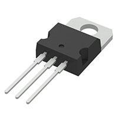 | \* Fixed 5V output \* Simple circuit design \* Can supply up to approximately 1.5A under suitable thermal conditions \* Widely used through-hole package | \* Requires adequate input-to-output voltage headroom \* Can dissipate substantial heat at high currents \* Requires thermal management and appropriate capacitors |
| MCP1827-ADJE/AT | 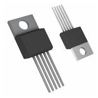 | \* Adjustable output voltage \* Rated for 1.5A output current \* Low dropout voltage \* Low quiescent current \* Thermal and short-circuit protection | \* Maximum input voltage is 6V, so it cannot regulate a 9V input directly \* Requires external resistors to set the output voltage \* Linear-regulator efficiency decreases with increasing voltage drop |
| TPS75901KCG3 | 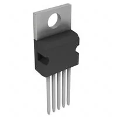 | \* High current capability, up to 7.5A for the TPS759 family \* Low dropout voltage \* Enable and power-good features \* Adjustable output voltage | \* Input voltage must remain within the device's specified range, up to 5.5V \* Not suitable for direct 9V-to-5V regulation \* Higher current capability may be unnecessary for a 1.5A application \* Requires careful output-capacitor selection |

**Choice:** Option 1: L7805ABV-DG 5V linear voltage regulator

**Rationale:** The L7805ABV-DG is the preferred choice because it provides a fixed 5V output and can support the required current under suitable thermal conditions. Its straightforward design simplifies circuit implementation. However, the power dissipated as heat must be considered carefully. With a 9V input and a 5V output at 1.5A, the regulator would dissipate approximately 6W, so appropriate heat sinking is necessary. A switching regulator may be more efficient if the circuit operates near its maximum current for extended periods.

### Speaker

**Audio Output Speaker**

| **Solution** | **Image** | **Pros** | **Cons** |
| --- | --- | --- | --- |
| CMS-28528N-L152 | 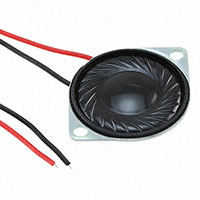 | \* Compact 28 mm diameter speaker \* Nominal 8-ohm impedance \* Up to 3W maximum input power \* Frequency response extends to approximately 20 kHz \* Lightweight construction | \* Approximately 750 Hz resonant frequency limits low-frequency performance \* Requires an amplifier for suitable output volume \* Small size limits bass response \* Maximum power rating must not be exceeded |
| FR 8 - 8 OHM |  | \* 8-ohm nominal impedance \* Suitable for applications designed around an 8-ohm speaker \* Potentially useful for general audio output | \* Requires an amplifier compatible with its impedance and power rating \* Physical size may limit enclosure options \* Exact power handling and sensitivity must be verified |
| CSS-1021028N | 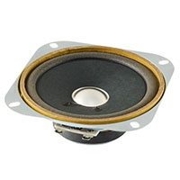 | \* Compact speaker option \* Potentially suitable for space-constrained designs \* Can be evaluated for basic audio or alert output | \* Exact impedance and power rating must be verified \* Small speakers may have limited bass response and maximum volume \* Requires a compatible amplifier |

**Choice:** Option 2: FR 8 - 8 OHM speaker

**Rationale:** The FR 8 - 8 OHM is the preferred choice because its nominal 8-ohm impedance can be compatible with a wide range of audio amplifier circuits designed for 8-ohm loads. Its suitability for the project will depend on its rated power handling, sensitivity, physical dimensions, and frequency response. These specifications should be confirmed before finalizing the circuit and enclosure design.

### 9V 3A Unregulated Power Supply

**DC Power Input Connectors**

*Note: PJ-102AH, PJ-050AH, and RAPC722X are connector part numbers, not complete power supplies. The comparison below concerns their suitability for connecting an external 9V, 3A supply.*

| **Solution** | **Image** | **Pros** | **Cons** |
| --- | --- | --- | --- |
| PJ-102AH | 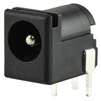 | \* Through-hole, right-angle barrel jack \* 5.5 mm outer diameter and 2.0 mm inner diameter \* Rated for up to 5A \* Suitable current rating for a 3A supply | \* Requires a matching 5.5 mm / 2.0 mm plug \* Right-angle orientation constrains PCB layout \* Rated for 24V DC maximum, not a voltage regulator |
| PJ-050AH | 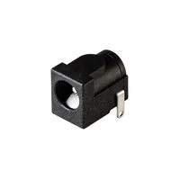 | \* Alternative barrel-jack option \* May provide a compact power-input connection \* Can be used if its dimensions and ratings match the supply | \* Exact dimensions and current rating must be verified \* Plug compatibility must be confirmed \* Must not be assumed to support 3A without datasheet verification |
| RAPC722X | 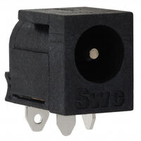 | \* Alternative DC power connector \* May offer a suitable panel-mount or chassis connection, depending on its specification \* Can simplify external power connections | \* Exact connector configuration and current rating must be verified \* May require additional mounting space \* Requires a matching plug and compatible wiring |

**Choice:** Option 1: PJ-102AH DC power connector

**Rationale:** The PJ-102AH is the preferred choice because its documented current rating of up to 5A exceeds the project's 3A requirement. Its through-hole, right-angle configuration is suitable for PCB mounting. The mating plug must match the connector's dimensions, and the power supply's polarity must be verified before connecting it to the circuit.

### Batteries

**9V Batteries**

| **Solution** | **Image** | **Pros** | **Cons** |
| --- | --- | --- | --- |
| EN22 | 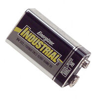 | \* Standard 9V battery format \* Convenient replacement option \* Suitable for low-power electronics and intermittent use \* Widely available battery type | \* Not suitable for sustained 3A loads \* High current draw causes significant voltage drop and short runtime \* Disposable battery replacement adds recurring cost \* Performance depends on load and temperature |
| A1604 BK210J |  | \* Standard 9V battery format \* Convenient and widely compatible with 9V battery holders \* Simple to replace \* Suitable for low-current portable applications | \* Limited capacity at high current draws \* Voltage drops as the battery discharges \* Not ideal for sustained 3A loads \* Battery chemistry and discharge characteristics must be verified |
| 6LF22XWA/B | 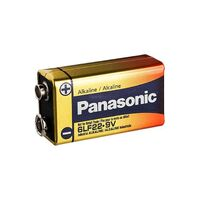 | \* Standard 9V battery format \* Convenient for portable devices \* No charging circuitry required if used as a primary battery \* Suitable for intermittent, low-current loads | \* Not suitable for sustained 3A loads \* Voltage sag and short runtime at high currents \* Capacity depends on discharge rate and battery chemistry \* Exact manufacturer specifications should be confirmed |

**Choice:** Option 2: A1604 BK210J 9V battery

**Rationale:** The A1604 BK210J is the preferred choice because its standard 9V format is convenient to integrate into a portable circuit and easy to replace. It is most appropriate for low-current operation or intermittent loads. If the project requires a sustained current approaching 3A, this battery is not suitable; a higher-capacity rechargeable battery pack designed for the required discharge current should be considered instead.

### Transistors

**Small-Signal Bipolar Junction Transistors**

| **Solution** | **Image** | **Pros** | **Cons** |
| --- | --- | --- | --- |
| 2N3904 |  | \* General-purpose NPN transistor suitable for switching and amplification \* Collector-emitter voltage rating of 40V \* Collector current rating of up to 200mA \* Widely available and inexpensive \* Suitable for low-power circuit applications | \* Limited to low-current applications \* Requires a base resistor for typical switching applications \* Not suitable for directly driving high-current loads |
| 2N3906 |  | \* General-purpose PNP transistor suitable for switching and amplification \* Complementary counterpart to the 2N3904 \* Collector-emitter voltage rating of approximately 40V \* Useful for high-side switching and complementary amplifier circuits \* Widely available and inexpensive | \* Limited to low-current applications \* Requires appropriate base biasing and current limiting \* PNP operation may require different control logic than an NPN transistor |
| 2N3904BK | 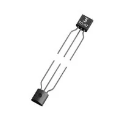 | \* General-purpose NPN transistor suitable for switching and amplification \* 40V collector-emitter voltage rating \* Common TO-92 through-hole package \* Low-cost alternative to other 2N3904 variants \* Suitable for low-power circuit applications | \* Limited to low-current applications \* Requires a base resistor for typical switching applications \* Electrical characteristics and package pinout should be verified against the selected manufacturer's datasheet |

**Choice:** Options 1 and 2: 2N3904 NPN transistor and 2N3906 PNP transistor

**Rationale:** The 2N3904 and 2N3906 are the preferred choices because they provide complementary NPN and PNP transistor operation for general-purpose switching and amplification. Using both types allows the circuit to support different switching configurations and complementary analog stages. Their low cost and widespread availability make them practical choices for a student electronics project. The 2N3904BK is a viable alternative NPN transistor, but it offers no fundamental functional advantage over a standard 2N3904 without a specific manufacturer or sourcing requirement.

