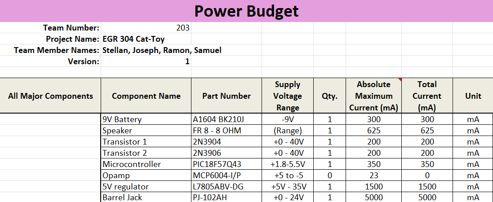
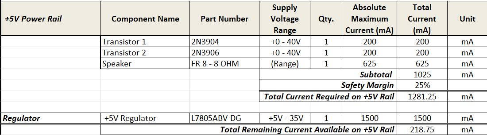
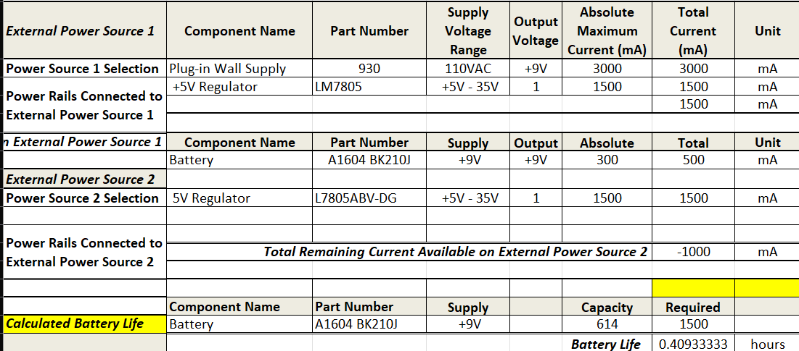

## Overview
This power budget was a critical step in creating our product. By calculating the current taken by each component, we can determine whether or not we have enough power to ensure proper operations, within a 25% safety margin. 

> Power Budget can be found below.

{style width:"350" height:"300;"}

{style width:"350" height:"300;"}

{style width:"350" height:"300;"}

## Conclusions

From the prepared Power Budget, it can be determined that a 9V battery is not enough to operate the speaker. Therefore, a wall-based power supply will be needed. This is informative for both our current design, and for potential future iterations on the design.

## Resouces

The power budget as a PDF download is available [*here*](PowerBudget304.pdf), and a Microsoft Excel Sheet [*here*](PowerBudget304.xlsx).
