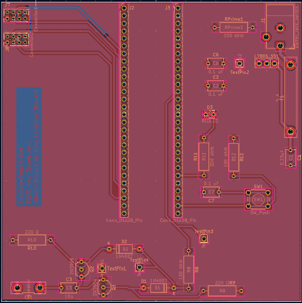
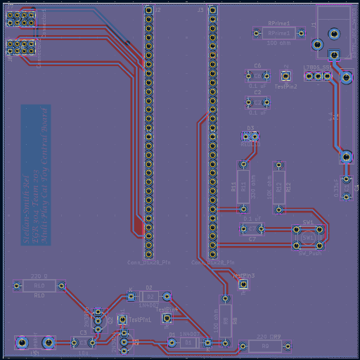

## Overview

This PCB is designed to support the hub-spoke operation of a multi-part cat toy, with this being the hub. There are multiple connectors to allow for off-board communication. Additionally, there is a simple speaker circuit that does not require a H-Bridge to operate, instead using an AB Amp, and a voltage regulator to supply 5V power to all circuit nets. The Curiosity Nano microcontroller manages all aspects of the circuit. The PCB uses a +5V Power and Earth planes on the bottom and top of the board, respectively. This allows for easier trace pathing and soldering of components to the board.

**Figure 1:** This is the image of the top of the PCB.

**Figure 2:** This is the image of the bottom of the PCB.

## Resouces

The schematic as a PDF download is available [*here*](FinalDesignPCB.pdf) and [*here*](FinalDesignPCBT.pdf), and the Zip folder of the project [*here*](Gerber.zip
).
